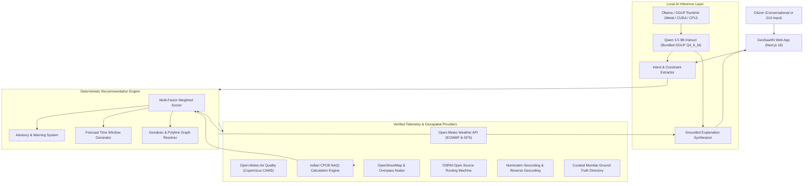

# GeoSaarthi AI — Personalized GeoAI Outdoor Activity & Environmental Assistant

[-8b5cf6?style=for-the-badge)](https://ollama.com)
[](https://nextjs.org)
[](https://maplibre.org)
[-38bdf8?style=for-the-badge)](https://open-meteo.com)

**GeoSaarthi AI** is an intelligent, privacy-preserving outdoor activity and environmental recommendation platform.

It bridges a locally bundled reasoning model (**Qwen 3.5 9B**) with real-time geospatial data, live numerical weather forecasting, Copernicus atmospheric monitoring, Indian CPCB / Global EPA Air Quality Indexes, and OSRM graph routing to answer:
1. *Where should I go for an outdoor activity?*
2. *What is the best time to go?*
3. *Which nearby places are suitable?*
4. *What route should I take from my current location?*
5. *What are the real-time weather and air quality conditions?*
6. *Are there any safety concerns or health advisories?*
7. *Why is this specific venue recommended?*

---

## 1. Technologies Used

GeoSaarthi AI is built entirely on modern, open-source technologies with **zero required API keys** and **100% local, on-device AI inference**:

### Core Application & Frontend Stack
- **Framework:** [Next.js 16 (App Router)](https://nextjs.org) with React 19 and Turbopack compiler.
- **Language:** TypeScript 5 (Strict type safety across engine, APIs, and components).
- **Styling & Design System:** Custom Vanilla CSS with responsive design tokens, glassmorphism cards (`backdrop-filter: blur`), dark-mode palette, and micro-animations.
- **Icons:** [Lucide React](https://lucide.dev) iconography.

### Geospatial & Mapping
- **Map Renderer:** [MapLibre GL JS](https://maplibre.org) v6 with custom local Web Worker integration (`public/maplibre-gl-worker.mjs`).
- **Map Tiles:** OpenStreetMap direct raster tile layers (100% free, zero-watermark, zero API key requirement).
- **Geocoding & Reverse Geocoding:** OpenStreetMap [Nominatim API](https://nominatim.org) with in-memory caching and reverse-geocoding for live GPS coordinates.
- **Routing Engine:** [OSRM (Open Source Routing Machine)](http://project-osrm.org) pedestrian and cycling road-network graphs with geodesic curvature fallback.
- **Spatial Calculations:** Haversine great-circle distance matrix and boundary geometry resolvers.

### Local AI & Reasoning Engine
- **Model:** **Qwen 3.5 9B** (9.7 Billion parameters, Q4_K_M quantized GGUF, ~6.14 GB on disk).
- **Bundled Offline Weights:** Stored directly in `models/qwen3.5-9b.gguf` with pre-indexed storage in `models/ollama/` and `models/Modelfile`.
- **Inference Runtime:** [Ollama](https://ollama.com) (leveraging Metal acceleration on Apple Silicon, CUDA/ROCm on Linux/Windows, or CPU threads) or standard GGUF runtimes (`llama.cpp` / `llama-server`).
- **Reasoning Sanitization:** Dynamic chain-of-thought `<think>...</think>` tag stripping for clean, conversational output.
- **Factual Grounding:** Zero-hallucination constraint pipeline where local AI explains only verified backend telemetry and ground truth numbers.

### Environmental & Meteorological Telemetry
- **Weather Forecasts:** [Open-Meteo Weather API](https://open-meteo.com) (ECMWF & NOAA GFS numerical prediction models, 15-minute resolution).
- **Air Quality:** [Open-Meteo Air Quality API](https://open-meteo.com/en/docs/air-quality-api) incorporating European Copernicus Atmosphere Monitoring Service (CAMS) satellite and ground assimilation.
- **Dual AQI Standards:**
  - **Indian CPCB NAQI:** Official National Air Quality Index calculated dynamically from PM2.5 and PM10 using Central Pollution Control Board breakpoints (*Good, Satisfactory, Moderate, Poor, Very Poor, Severe*).
  - **Global EPA AQI:** International US EPA standard (0–500 scale) with live category mapping.
- **Pollutants Monitored:** PM2.5, PM10, Nitrogen Dioxide (NO₂), Ground-level Ozone (O₃), and Sulphur Dioxide (SO₂).

### Testing & Developer Tooling
- **Test Runner:** Node.js native test runner (`node:test`) executed with `tsx`.
- **Linting:** ESLint 9 with Next.js core web vitals configuration.

---

## 2. How to Start

### Option 1: One-Click Startup (Recommended & Portable)

GeoSaarthi AI includes cross-platform launcher scripts that automatically verify dependencies, detect the bundled Qwen 3.5 9B model, start the local inference runtime, and launch the website.

#### On macOS / Linux:
```bash
./start.sh
```
*(Or run `node scripts/start-all.js` directly)*

#### On Windows:
Double-click **`start.bat`** in the project folder, or run in PowerShell:
```powershell
.\start.ps1
```

The launcher will:
1. Verify Node.js is installed.
2. Auto-install `npm install` packages if running for the first time.
3. Verify the bundled Qwen 3.5 9B model in `models/`.
4. Point `OLLAMA_MODELS` to the local bundled directory and start the background inference service (if not already running).
5. Start the Next.js web application.
6. Automatically open **[http://localhost:3000](http://localhost:3000)** in your default browser.

---

### Option 2: Manual Developer Setup

If you prefer to start each component manually:

#### 1. Prerequisites
- **Node.js:** v18 or higher (tested on Node v20 & v22).
- **Local LLM Runtime:** [Ollama](https://ollama.com) installed.

#### 2. Install Project Dependencies
```bash
git clone https://github.com/06charles/GeoSaarthiAI.git
cd GeoSaarthiAI
npm install
```

#### 3. Start Local AI Inference
You can either use the bundled offline weights or standard Ollama:
```bash
# Using the bundled offline weights without downloading:
OLLAMA_MODELS=./models/ollama ollama serve

# Or register from the included Modelfile:
ollama create qwen3.5:9b -f ./models/Modelfile
```

#### 4. Run the Automated Test Suite
```bash
npm test
```
*Executes all 9 automated tests verifying activity definitions, Mumbai coordinates, weather telemetry, air quality, OSRM routing, scoring weights, and local LLM connectivity.*

#### 5. Launch the Development Server
```bash
npm run dev
```
Open **[http://localhost:3000](http://localhost:3000)** in your browser.

---

### Option 3: Production Build & Execution

To compile and serve an optimized production build:
```bash
npm run build
npm start
```

---

## 3. Geographical Scope

- **Primary Supported City:** **Mumbai Metropolitan Region (MMR)** (Powai, Bandra, Marine Drive, Borivali, Dadar, Andheri, Navi Mumbai, Taloja, Chembur, Colaba, Worli, etc.).
- **Automatic Device Geolocation:** Automatically detects your browser GPS coordinates on launch, reverse-geocodes your actual neighborhood (e.g., *Current Location: Taloja*), places a pulsing radar pin on the map, and routes from your real-time position.
- **Extensible Architecture:** Modular city bounds (`MUMBAI_BOUNDS`, `DEFAULT_CITY`) enable onboarding Pune, Bengaluru, or Delhi NCR by updating configuration files.

---

## 4. Supported Activities (All 10 Activities)

GeoSaarthi AI implements multi-factor weighted scoring across 10 outdoor disciplines:

| # | Activity | Category | Key Suitability Factors | Verified Mumbai Venues |
| :--- | :--- | :--- | :--- | :--- |
| **1** | **Jogging & Running** | Fitness | Weather (35%), AQI (35%), Low traffic, Footway surface | Marine Drive, Carter Road, Powai Lake, Lokhandwala |
| **2** | **Cycling** | Fitness | Smooth asphalt, AQI (35%), Route distance, Early-bird safety | BKC Green Track, Bandstand Loop, Palm Beach Corridor |
| **3** | **Golf** | Sport | 18-hole greens, Wind & rain sensitivity (5/5), Fairways | Bombay Presidency Golf Club, Willingdon, Kharghar Valley |
| **4** | **Cricket** | Sport | Red soil wickets, Outfield grass, Rain sensitivity (5/5) | Shivaji Park Maidan, Oval Maidan, IIT Bombay Gymkhana |
| **5** | **Outdoor Football** | Sport | AstroTurf / Natural grass, Floodlights, Rain tolerance | Cooperage Stadium, D'Monte Bandra Turf, Andheri Complex |
| **6** | **Outdoor Tennis** | Sport | Hardcourt / Clay, Wind stability (4/5), Evening floodlights | MSLTA Colaba, Bandra Gymkhana Courts, Forest Club Powai |
| **7** | **Hiking & Nature Walks** | Nature | Forest dirt trails, Elevation, Canopy, High heat sensitivity | SGNP Kanheri Trail, Shilonda Forest, Yeoor Hills |
| **8** | **Picnics & Leisure** | Recreation | Botanical lawns, Shaded pavilions, Zero traffic noise | Hanging Gardens, Bandra Fort Garden, Kharghar Central Park |
| **9** | **Outdoor Events** | Culture | Amphitheatres, Cultural maidans, Evening lighting | NCPA Waterfront Lawns, MMRDA / Jio World Garden |
| **10** | **Outdoor Photography** | Recreation | Golden-hour lighting, Scenic viewpoints, Sea horizons | Gateway of India Plaza, Worli Sea Face, Horniman Circle |

---

## 5. System Architecture



---

## 6. HTTP API Reference

| Endpoint | Method | Description |
| :--- | :--- | :--- |
| `/api/chat` | `POST` | Conversational NLP query processing via local Qwen 3.5 9B with grounded facts |
| `/api/recommendations` | `POST` | Deterministic ranking of outdoor venues based on weather, AQI, distance, and surface |
| `/api/weather` | `GET` | Fetches live hourly temperature, feels-like, UV, wind, and rain probability |
| `/api/air-quality` | `GET` | Fetches live Copernicus PM2.5, PM10, gases, Indian CPCB AQI, and US EPA AQI |
| `/api/locations/search` | `GET` | Forward geocoding and Mumbai neighborhood autocomplete via Nominatim |
| `/api/locations/reverse` | `GET` | Reverse geocodes GPS coordinates into human-readable localities |
| `/api/routes` | `GET` | Resolves point-to-point outdoor route geometry and distances via OSRM |
| `/api/health` | `GET` | Reports local AI engine connectivity and bundled model weights verification |

---

## 7. Safety & Advisory Thresholds

GeoSaarthi AI automatically cross-references incoming telemetry against safety thresholds:
- **Extreme Heat Advisory:** Triggered when feels-like temperature &ge; 37°C. Advises avoiding midday sun and shifting to morning/evening slots.
- **Slick Surface & Rain Alert:** Triggered when rain probability &ge; 70% or precipitation &ge; 5.0 mm.
- **Air Quality Particulate Alert:** Triggered when PM2.5 &ge; 150 µg/m³ or Indian AQI &ge; 200 (*Poor / Very Poor / Severe*). Strenuous cardiovascular exertion discouraged; mask recommended.
- **Low Light Warning:** Triggered after sunset if venue lacks verified evening floodlights.

---

## 8. Bundled Model Verification & Redistribution

- **File Location:** `models/qwen3.5-9b.gguf` (6.14 GB)
- **Format:** GGUF v3 (Q4_K_M)
- **Model Architecture:** Qwen 3.5 (9B parameters)
- **License:** Open weights under Apache 2.0
- **Redistribution:** The entire repository (including `models/`, source code, and scripts) can be zipped into a single archive and run on any machine without separate model downloads.
